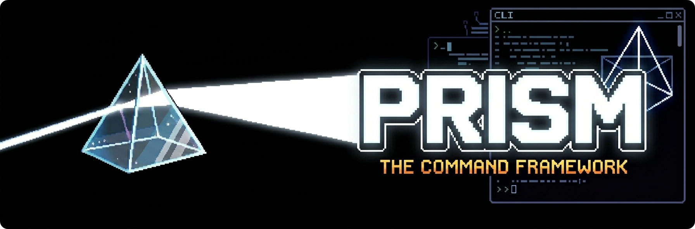

# 🌟 Prism - THE Command Framework

<div align="center">

A code-first command framework that lets you build commands directly in Java with a fluent, type-safe API.
**No annotations required.**



[](https://central.sonatype.com/namespace/dev.gurwi)
[](https://github.com/AthlasStudios/prism/actions/workflows/test.yml)
[](https://adoptium.net)
[](https://github.com/AthlasStudios/prism/blob/main/LICENSE)

[](https://github.com/AthlasStudios/prism/stargazers)
[](https://github.com/AthlasStudios/prism/issues)
[](https://github.com/AthlasStudios/prism/commits/main)


[Documentation](https://docs.gurwi.dev/prism) · [Issues](https://github.com/AthlasStudios/prism/issues)

</div>

---

## Table of contents

- [Why Prism?](#why-prism)
- [Features](#features)
- [Supported platforms](#supported-platforms)
- [Installation](#installation)
- [Quick start](#quick-start)
- [Guide](#guide)
  - [Arguments](#arguments)
  - [Optional arguments](#optional-arguments)
  - [Subcommands](#subcommands)
  - [Argument trees](#argument-trees)
  - [Executors and senders](#executors-and-senders)
  - [Permissions and requirements](#permissions-and-requirements)
  - [Suggestions and tab completion](#suggestions-and-tab-completion)
  - [Flags](#flags)
  - [Built-in help](#built-in-help)
  - [Registering and unregistering](#registering-and-unregistering)
- [Platform configuration](#platform-configuration)
- [Built-in argument types](#built-in-argument-types)
- [Implementing your own platform](#implementing-your-own-platform)
- [Project structure](#project-structure)
- [Building from source](#building-from-source)
- [Trying it out on a server](#trying-it-out-on-a-server)
- [Contributing](#contributing)
- [License](#license)

---

## Why Prism?

Most command frameworks lean on annotations and reflection: you describe a command with a pile of annotations, and the framework figures out the rest at runtime. Prism takes the opposite approach. A command is plain Java code built with a fluent builder, so you get:

- **Compile-time safety.** Arguments, executors and requirements are real typed objects, not strings buried in annotations.
- **Composability.** Commands are values. Build them in loops, share argument definitions, and assemble trees programmatically.
- **Discoverability.** Your IDE's autocomplete is the documentation. Everything hangs off one builder.
- **One API, many platforms.** The core is platform-agnostic; Spigot, Paper (with native Brigadier support) and others plug in on top.

```java
new PrismBukkitCommand("heal")
        .withDescription("Heal a player")
        .withPermission("myplugin.heal")
        .withArguments(new PlayerArgument("target"))
        .executes((sender, args) -> {
            Player target = args.get("target");
            target.setHealth(20);
            sender.sendMessage("Healed " + target.getName());
        })
        .register(platform);
```

## Features

- 🧱 **Fluent, type-safe builder API** with no annotations
- 🌳 **Subcommands and argument trees** for arbitrarily nested command structures
- 🎯 **Rich built-in arguments** for players, worlds, materials, locations, entity selectors, ranges, colors, enchantments, potion effects and more
- 💡 **Sync and async tab completion** with optional tooltips
- 🚩 **Flag support** (`-c red -e`) via `FlagArgument`
- 🔐 **Permissions and usage requirements** at the command and argument level
- 🧭 **Per-sender-type executors** for players, console, remote console, command blocks and proxied senders
- ⚡ **Native Brigadier integration** (client-side validation, colored syntax, native suggestions) with an automatic **legacy fallback**
- 📖 **Built-in help generator** that renders clickable usage for a command tree
- ♻️ **Runtime registration and unregistration** of commands
- 🧩 **Shaded bundles** so you ship a single dependency

## Supported platforms

| Platform                          | Module                                 | Status            |
|-----------------------------------|----------------------------------------|-------------------|
| Spigot (and forks)                | `prism-spigot`                         | Supported         |
| Paper (and forks)                 | `prism-paper`                          | Supported         |
| Brigadier (Minecraft 1.13 → 26.x) | bundled in the Spigot and Paper builds | Supported         |
| JDA (Discord)                     | `platform/jda`                         | 🚧 In development |

Prism compiles against the Spigot 1.13.2 API, and the Brigadier layer has per-version adapters for Minecraft **1.13 through 1.21 and 26.x**. If Brigadier can't be initialized on your server version, Prism logs a warning and falls back to legacy registration, so commands keep working.

## Installation

> Prism is currently in **beta** (`1.0.0-beta.4`). APIs may still change between beta releases.

Group ID: `dev.gurwi`

| Server software | Artifact ID    |
|-----------------|----------------|
| Paper           | `prism-paper`  |
| Spigot          | `prism-spigot` |

Each artifact is a self-contained bundle that already includes the core, Bukkit layer and the matching Brigadier adapters, so you only add one dependency.

### Gradle (Kotlin DSL)

```kotlin
repositories {
    mavenCentral()
}

dependencies {
    implementation("dev.gurwi:prism-paper:1.0.0-beta.4")
}
```

### Gradle (Groovy DSL)

```groovy
repositories {
    mavenCentral()
}

dependencies {
    implementation 'dev.gurwi:prism-paper:1.0.0-beta.4'
}
```

### Maven

```xml
<dependency>
    <groupId>dev.gurwi</groupId>
    <artifactId>prism-paper</artifactId>
    <version>1.0.0-beta.4</version>
</dependency>
```

Swap `prism-paper` for `prism-spigot` if you target Spigot. The individual modules (`prism-core`, `prism-bukkit`, `prism-brigadier` and `prism-brigadier-minecraft`) are published too, but most projects should use a bundle.

Prism is a library, not a standalone plugin, so **shade it into your own plugin jar** (for example with the [Shadow](https://github.com/GradleUp/shadow) plugin) and relocate it to avoid conflicts with other plugins that bundle Prism.

## Quick start

### 1. Create the platform

Do this once, in `onEnable`.

**Paper**

```java
public class MyPlugin extends JavaPlugin {

    private PaperPlatform platform;

    @Override
    public void onEnable() {
        this.platform = PaperPlatform.configure(this).init();
    }
}
```

**Spigot**

```java
public class MyPlugin extends JavaPlugin {

    private SpigotPlatform platform;

    @Override
    public void onEnable() {
        this.platform = SpigotPlatform.configure(this).init();
    }
}
```

### 2. Build and register a command

```java
new PrismBukkitCommand("teleport", "tp")
        .withDescription("Teleport yourself to a location")
        .withPermission("myplugin.teleport")
        .withArguments(new LocationArgument("location"))
        .executesPlayer((player, args) -> {
            Location location = args.get("location");
            player.teleport(location);
            player.sendMessage("Teleported!");
        })
        .register(platform);
```

That's it. The first argument is the command name; any further strings are aliases. Tab completion, argument parsing and error messages come for free.

## Guide

### Arguments

Required arguments are added with `withArguments(...)`. They are parsed in order, and values are read back by name from the `CommandArguments` object passed to your executor.

```java
new PrismBukkitCommand("give")
        .withArguments(
                new PlayerArgument("target"),
                new MaterialArgument("material"),
                new IntegerArgument("amount", 1, 64)
        )
        .executes((sender, args) -> {
            Player target = args.get("target");
            Material material = args.get("material");
            int amount = args.get("amount");

            target.getInventory().addItem(new ItemStack(material, amount));
        })
        .register(platform);
```

`args.get(...)` is generic, so the target type is inferred from the variable you assign it to. You can also pass the argument object itself instead of its name:

```java
IntegerArgument amount = new IntegerArgument("amount", 1, 64);
// ...
int value = args.get(amount);
```

### Optional arguments

Optional arguments are declared with `withOptionalArguments(...)` and always come after the required ones.

```java
new PrismBukkitCommand("number")
        .withArguments(new IntegerArgument("number", 0, 10))
        .withOptionalArguments(new FloatArgument("float", 0.1f, 9.9f))
        .executes((sender, args) -> {
            int number = args.get("number");
            float scale = args.getOptional("float", 1.0f); // with a default
            sender.sendMessage(number + " x " + scale);
        })
        .register(platform);
```

`getOptional(key)` returns an `Optional<T>`, and `getOptional(key, defaultValue)` returns the value or your default.

### Subcommands

Nest commands with `withSubCommands(...)`. A subcommand is just another `PrismBukkitCommand`.

```java
new PrismBukkitCommand("team", "t")
        .withDescription("Team management")
        .withSubCommands(
                new PrismBukkitCommand("create")
                        .withArguments(new StringArgument("name"))
                        .executes((sender, args) -> {
                            sender.sendMessage("Created team " + args.get("name"));
                        }),

                new PrismBukkitCommand("join")
                        .withArguments(new StringArgument("name"))
                        .executesPlayer((player, args) -> {
                            player.sendMessage("Joined team " + args.get("name"));
                        })
        )
        .register(platform);
```

A subcommand can read arguments from its parents by path, using `getAt` with a `../`-style path:

```java
new PrismBukkitCommand("paint")
        .withArguments(new ColorArgument("color"))
        .withSubCommands(
                new PrismBukkitCommand("call")
                        .executes((sender, args) -> {
                            // Read "color" from the parent command
                            sender.sendMessage("Color: " + args.getAt("../", "color"));
                        })
        )
        .register(platform);
```

`CommandArguments` also exposes the definition chain (`getParent()`, `getRoot()`, `getChain()`, `getChildDefinitions()`) if you need to inspect where you are in the tree.

### Argument trees

When a command needs different follow-up arguments depending on the path taken, use `then(...)`. Each branch can carry its own executor.

```java
new PrismBukkitCommand("prism", "pri")
        .withArguments(new ItemStackPredicateArgument("predicate"))
        .then(
                new MaterialArgument("material")
                        .executes((sender, args) -> {
                            Material material = args.get("material");
                            sender.sendMessage("Selected material " + material);
                        })
        )
        .then(
                new GameModeArgument("gamemode")
                        .executes((sender, args) -> {
                            GameMode gameMode = args.get("gamemode");
                            sender.sendMessage("Selected game mode " + gameMode);
                        })
        )
        .register(platform);
```

Branches can be nested further by calling `.then(...)` on an argument. Argument names must be unique among siblings, and Prism throws an `IllegalArgumentException` if you reuse one or try to add an argument beneath itself.

### Executors and senders

Pick the executor that matches who may run the command. Prism only invokes the executor that fits the sender, so you don't need `instanceof` checks.

| Method | Sender type |
| --- | --- |
| `executes(...)` | Any `CommandSender` |
| `executesPlayer(...)` | `Player` |
| `executesConsole(...)` | `ConsoleCommandSender` |
| `executesRemoteConsole(...)` | `RemoteConsoleCommandSender` |
| `executesProxy(...)` | `ProxiedCommandSender` |
| `executesBlock(...)` | `BlockCommandSender` |

You can register several executors on the same command, one per sender type:

```java
new PrismBukkitCommand("whoami")
        .executesPlayer((player, args) -> player.sendMessage("You are " + player.getName()))
        .executesConsole((console, args) -> console.sendMessage("You are the console"))
        .register(platform);
```

Use `clearExecutors()` to remove all executors from a builder.

### Permissions and requirements

**Permissions** are checked against the sender (operators always pass):

```java
new PrismBukkitCommand("admin")
        .withPermission("myplugin.admin", "myplugin.staff")
        // ...
```

For wildcard-style checks, `BukkitPermission.startsWith("myplugin.")` matches any effective permission with that prefix.

**Requirements** are arbitrary predicates on the sender. Sender-specific shortcuts are available:

```java
new PrismBukkitCommand("fly")
        .withPlayerRequirement(player -> player.getWorld().getName().equals("lobby"))
        .executesPlayer((player, args) -> player.setAllowFlight(true))
        .register(platform);
```

Available helpers: `withRequirement`, `withPlayerRequirement`, `withConsoleRequirement`, `withRemoteConsoleRequirement`, `withProxyRequirement` and `withBlockRequirement`. Requirements can also be attached to individual arguments with `withRequirement(...)`, and arguments can be hidden from listings with `setListed(false)`.

### Suggestions and tab completion

Every built-in argument ships with sensible default suggestions. Replace them with `replaceSuggestions(...)`.

**Static strings**

```java
new IntegerArgument("number", 0, 10).replaceSuggestions("5", "10");
```

**Synchronous, computed suggestions (with tooltips)**

```java
new StringArgument("kit").replaceSuggestions(
        BukkitSuggestionsSupplier.sync(ctx -> List.of(
                BukkitSuggestion.of("starter", "The default starter kit"),
                BukkitSuggestion.of("vip", "Perks for VIP players")
        ))
);
```

**Asynchronous suggestions** (for database or network lookups) return a `CompletableFuture`:

```java
new StringArgument("player").replaceSuggestions(
        BukkitSuggestionsSupplier.async(ctx -> CompletableFuture.supplyAsync(() ->
                List.of(BukkitSuggestion.of("alpha", "first async value"))
        ))
);
```

The `SuggestionContext` passed in gives you access to the current raw input (`ctx.getCurrentRawArg()`) so you can filter results. Helpers `BukkitSuggestionsSupplier.strings(...)` and `stringsAsync(...)` cover the plain-string cases.

> On Paper, async suggestions are handled through a dedicated listener. You can turn this off with `disableAsyncSuggestions()` (see [Platform configuration](#platform-configuration)).

### Flags

`FlagArgument` parses `-x`-style flags in any order. Flags can carry a value (using any other argument type) or act as simple on/off switches.

```java
new PrismBukkitCommand("flagger")
        .withArguments(
                new FlagArgument("flags").flags(
                        Flag.valued(new ColorArgument("color"), 'c'),
                        Flag.presence("enable", 'e')
                )
        )
        .executesPlayer((player, args) -> {
            ParsedFlags flags = args.get("flags");
            Optional<ChatColor> color = flags.get("color");

            color.ifPresent(c -> player.sendMessage("Color: " + c.name()));
        })
        .register(platform);
```

### Built-in help

`CommandHelp` renders a clickable usage list for the current command, including its subcommands and argument-tree branches. It only shows entries the sender is actually allowed to run.

```java
new PrismBukkitCommand("myplugin")
        .withSubCommands(/* ... */)
        .executesPlayer((player, args) -> CommandHelp.help(player, args))
        .register(platform);
```

Pass two extra `ChatColor` values to `CommandHelp.help(sender, args, primary, secondary)` to restyle it.

### Registering and unregistering

A command can be registered in two equivalent ways:

```java
// 1. Directly from the builder
BukkitCommandDefinition definition = new PrismBukkitCommand("hello")
        .executes((sender, args) -> sender.sendMessage("Hello!"))
        .register(platform);

// 2. Build first, register later
BukkitCommandDefinition built = new PrismBukkitCommand("hello")
        .executes((sender, args) -> sender.sendMessage("Hello!"))
        .build();

platform.getCommandsRegistry().register(built);
platform.getCommandsRegistry().unregister(built);
```

`getRegisteredCommands()` returns an unmodifiable view of everything registered on the platform.

## Platform configuration

Both `PaperPlatform.configure(plugin)` and `SpigotPlatform.configure(plugin)` return a builder. Finish with `.init()`.

| Option                                         | Platform      | Description                                                                      |
|------------------------------------------------|---------------|----------------------------------------------------------------------------------|
| `disableBrigadier()`                           | Paper, Spigot | Skip Brigadier and register through the legacy command system only.              |
| `disableLegacyRegistrar()`                     | Paper, Spigot | Disable the legacy registrar.                                                    |
| `disableAsyncSuggestions()`                    | Paper         | Don't register the async tab-completion listener.                                |
| `registerPermissions(boolean)`                 | Paper, Spigot | Toggle command permission registration. Defaults to `true`.                      |
| `withGlobalLegacyCommandErrorHandler(handler)` | Paper, Spigot | Set the default handler for argument-parse errors on legacy-registered commands. |

```java
PaperPlatform platform = PaperPlatform.configure(this)
        .disableAsyncSuggestions()
        .registerPermissions(false)
        .init();
```

Individual commands can override the error handler with `replaceErrorHandler(...)`. Prism ships `LegacyCommandExecutionErrorHandler.defaultHandler()` and `consoleHandler()`, and you can implement the interface yourself.

## Built-in argument types

All of these live in `dev.gurwi.prism.bukkit.argument`.

| Category                      | Arguments                                                                                                                                                                                                                                                    |
|-------------------------------|--------------------------------------------------------------------------------------------------------------------------------------------------------------------------------------------------------------------------------------------------------------|
| **Primitives**                | `StringArgument`, `GreedyStringArgument`, `MultiStringArgument`, `CharacterArgument`, `BooleanArgument`, `ByteArgument`, `ShortArgument`, `IntegerArgument`, `LongArgument`, `FloatArgument`, `DoubleArgument`, `UUIDArgument`                               |
| **Ranges**                    | `ByteRangeArgument`, `ShortRangeArgument`, `IntegerRangeArgument`, `LongRangeArgument`, `FloatRangeArgument`, `DoubleRangeArgument`, `NumberRangeArgument`                                                                                                   |
| **Players and entities**      | `PlayerArgument`, `OfflinePlayerArgument`, `EntityTypeArgument`, `EntitySelectorArgument` (e.g. `ManyEntities`)                                                                                                                                              |
| **World and position**        | `WorldArgument`, `LocationArgument`, `ColumnLocationArgument`, `BlockPositionArgument`, `ColumnBlockPositionArgument`, `VectorArgument`, `RotationArgument`, `AngleArgument`, `AxesArgument`                                                                 |
| **Blocks and items**          | `MaterialArgument`, `BlockStateArgument`, `BlockPredicateArgument`, `ItemStackPredicateArgument`, `EnchantmentArgument`                                                                                                                                      |
| **Game enums and registries** | `GameModeArgument`, `DifficultyArgument`, `WeatherArgument`, `BiomeArgument`, `PotionEffectTypeArgument`, `ParticleArgument`, `SoundArgument`, `DisplaySlotArgument`, `NamespacedKeyArgument`, `MirrorArgument`, `StructureRotationArgument`, `EnumArgument` |
| **Text and color**            | `ColorArgument`, `HexColorArgument`, `MessageArgument`, `TimeArgument`                                                                                                                                                                                       |
| **Structure**                 | `LiteralArgument`, `FlagArgument`                                                                                                                                                                                                                            |

Need something custom? Extend `BukkitArgument` (or one of the `base` argument classes) and implement `parse(...)`, and optionally provide default suggestions.

> Greedy arguments must be the last argument of a command and cannot have children.

## Implementing your own platform

`core` knows nothing about Minecraft, Discord or any other host. A platform is a thin layer that supplies six things on top of it, and everything else (the fluent builder, argument trees, subcommands, requirements, `CommandArguments`) comes for free. The `platform/bukkit` module is the full-featured reference, and `platform/jda` is a minimal skeleton that follows the same layout.

Add the core module (it is published on its own):

```kotlin
dependencies {
    api("dev.gurwi:prism-core:1.0.0-beta.4")
}
```

The examples below use an imaginary chat service where the command *source* is an `AcmeUser`.

### 1. Executor

An executor is a functional interface over your source type and your definition type.

```java
@FunctionalInterface
public interface AcmeExecutor extends CommandExecutor<AcmeUser, AcmeCommandDefinition> {
}
```

If your host has several kinds of senders (like Bukkit's player, console and command block), declare one executor interface per kind and register them under their own class, as `BukkitExecutorContainerBuilder` does.

### 2. Permissions

Implement `PermissionNode<Permission, Source>`. `permission()` returns your host's native permission value, and `hasPermission(...)` answers for a given source.

```java
public record AcmePermission(String node) implements PermissionNode<String, AcmeUser> {

    @Override
    public String permission() {
        return node;
    }

    @Override
    public boolean hasPermission(AcmeUser user) {
        return user.hasPermission(node);
    }
}
```

### 3. Arguments and suggestions

Extend `AbstractArgument` with your source type and a `SuggestionsSupplier`. The one method you must implement is `parse`. Throw `ArgumentParseException` for invalid input.

```java
@FunctionalInterface
public interface AcmeSuggestions<T> extends SuggestionsSupplier<AcmeUser, Collection<T>> {
}

public abstract class AcmeArgument<Impl extends AcmeArgument<Impl, T>, T>
        extends AbstractArgument<Impl, T, AcmeUser, AcmeSuggestions<T>> {

    public AcmeArgument(String name, AcmeSuggestions<T> defaultSuggestions) {
        super(name, defaultSuggestions);
    }
}

public class AcmeIntegerArgument extends AcmeArgument<AcmeIntegerArgument, Integer> {

    public AcmeIntegerArgument(String name) {
        super(name, ctx -> List.of());
    }

    @Override
    public Integer parse(AcmeUser source, String value) throws ArgumentParseException {
        try {
            return Integer.parseInt(value);
        } catch (NumberFormatException e) {
            throw new ArgumentParseException(this, value, "'" + value + "' is not a number");
        }
    }
}
```

If you want `then(...)` argument trees on your platform, extend `AbstractTreeArgument` instead and `AbstractTreeCommandBuilder` / `AbstractTreeCommandDefinition` in the next steps (this is what the Bukkit module does).

### 4. Command definition

The definition is the immutable, built form of a command. Subclass `AbstractCommandDefinition` and bind its type parameters (self type, source, executor, argument, permission). The builder is the only thing that constructs it.

```java
public class AcmeCommandDefinition extends AbstractCommandDefinition<
        AcmeCommandDefinition, AcmeUser, AcmeExecutor, AcmeArgument<?, ?>, AcmePermission> {

    protected AcmeCommandDefinition(@Nullable AcmeCommandDefinition parent, String name, List<String> aliases,
                                    String description, UsageRequirement<AcmeUser> requirement,
                                    Set<AcmePermission> permissions,
                                    List<AcmeArgument<?, ?>> requiredArguments,
                                    List<AcmeArgument<?, ?>> optionalArguments,
                                    Map<Class<? extends AcmeExecutor>, AcmeExecutor> executors,
                                    CommandChildrenFactory<AcmeCommandDefinition> childrenFactory) {
        super(parent, name, aliases, description, requirement, permissions,
                requiredArguments, optionalArguments, executors, childrenFactory);
    }
}
```

The base class already gives you `getName()`, `getAliases()`, `getChildren()`, `getChild(name)`, `getParent()`, `getExecutor(type)` and `canExecute(source)` (requirement plus all permissions).

### 5. Builder

Extend `AbstractCommandBuilder`, implement `build(parent)`, and add whatever convenience methods your executors need.

```java
public class AcmeCommandBuilder extends AbstractCommandBuilder<
        AcmeCommandBuilder, AcmeCommandDefinition, AcmeUser, AcmeExecutor, AcmeArgument<?, ?>, AcmePermission> {

    public AcmeCommandBuilder(String name, String... aliases) {
        super(name, aliases);
    }

    public AcmeCommandBuilder executes(AcmeExecutor executor) {
        return executes(AcmeExecutor.class, executor);
    }

    @Override
    public AcmeCommandDefinition build(@Nullable AcmeCommandDefinition parent) {
        return new AcmeCommandDefinition(parent, name, aliases, description, requirement, permissions,
                requiredArguments, optionalArguments, executors, CommandChildrenFactory.create(children));
    }
}
```

`withDescription`, `withArguments`, `withOptionalArguments`, `withPermission`, `withRequirement`, `withSubCommands` and `register(...)` are all inherited.

### 6. Platform and registry

The platform identifies itself and exposes its registry. The registry is where the work happens: it stores definitions and connects them to your host.

```java
public class AcmePlatform implements Platform<AcmeCommandsRegistry> {

    private final AcmeCommandsRegistry registry = new AcmeCommandsRegistry(this);

    @Override
    public String getIdentifier() {
        return "acme";
    }

    @Override
    public AcmeCommandsRegistry getCommandsRegistry() {
        return registry;
    }
}

public class AcmeCommandsRegistry implements CommandsRegistry<AcmePlatform, AcmeCommandDefinition> {

    private final AcmePlatform platform;
    private final Set<AcmeCommandDefinition> commands = new HashSet<>();

    public AcmeCommandsRegistry(AcmePlatform platform) {
        this.platform = platform;
    }

    @Override
    public void register(AcmeCommandDefinition definition) {
        commands.add(definition);
        // Tell your host about the command (name, aliases, description, ...)
    }

    @Override
    public void unregister(AcmeCommandDefinition definition) {
        commands.remove(definition);
        // Remove it from your host
    }

    @Override
    public @Unmodifiable Set<AcmeCommandDefinition> getRegisteredCommands() {
        return Set.copyOf(commands);
    }

    @Override
    public AcmePlatform getPlatform() {
        return platform;
    }
}
```

### 7. Dispatching input

Prism does not parse or run anything by itself. When your host receives input for a registered command, your registry (or a helper it owns) does the following:

1. Walk the definition tree, matching subcommand names with `getChild(...)`.
2. Check `definition.canExecute(source)` and report a "no permission" error if it fails.
3. Parse the raw tokens with each argument's `parse(source, token)`, honouring `canUse(source)`, and collect the values into two maps keyed by argument name (required and optional). Catch `ArgumentParseException` and turn it into a user-facing message.
4. Wrap the values in a `CommandArguments`, passing the parent's `CommandArguments` so that `getAt("../", "key")` and friends work.
5. Look up the executor with `definition.getExecutor(...)` and call `run(source, args)`.

```java
CommandArguments<AcmeCommandDefinition, AcmeUser> args =
        new CommandArguments<>(definition, requiredValues, optionalValues, parentArgs);

definition.getExecutor(AcmeExecutor.class)
        .ifPresentOrElse(
                executor -> executor.run(user, args),
                () -> user.sendMessage("This command cannot be run here.")
        );
```

For suggestions, call each argument's `getSuggestionsSupplier().getSuggestions(new SuggestionContext<>(source, currentInput, currentRawArg))` and translate the result into whatever your host expects.

### Using it

Once those pieces exist, users of your platform get the same fluent API as everyone else:

```java
AcmePlatform platform = new AcmePlatform();

new AcmeCommandBuilder("greet")
        .withArguments(new AcmeIntegerArgument("times"))
        .executes((user, args) -> {
            int times = args.get("times");
            user.sendMessage("Hello! ".repeat(times));
        })
        .register(platform);
```

> **Tip:** read `BukkitCommandsRegistry`, `LegacyCommandRegistrar` and `LegacyArgumentsParser` in `platform/bukkit` to see a complete implementation of steps 6 and 7, including tab completion, flags and greedy arguments.

## Project structure

Prism is a multi-module Gradle build:

```
prism
├── core/                  Platform-agnostic command model: builders, arguments, executors, permissions
├── reflection/            Small reflection helpers shared across platform modules
├── platform/
│   ├── bukkit/            Shared Bukkit API layer: PrismBukkitCommand, arguments, executors, legacy registrar
│   ├── spigot/            Spigot platform and registry
│   ├── paper/             Paper platform and registry (async suggestions, Paper-native Brigadier)
│   ├── brigadier/         Platform-independent Brigadier tree builder and adapter
│   │   └── minecraft/     Minecraft-facing Brigadier bridge
│   │       ├── V1_13 … V1_21, V26   Per-version adapters
│   │       └── brigadier-paper      Paper-native adapter
│   └── jda/               Discord (JDA) platform, in development
├── publish/
│   ├── paper/             Aggregates modules into the `prism-paper` bundle
│   └── spigot/            Aggregates modules into the `prism-spigot` bundle
├── gradle-plugin/
│   └── spigot-nms/        Gradle plugin for Spigot NMS reobfuscation
├── buildSrc/              Shared publishing conventions
└── test/plugin/           Paper test plugin used to exercise the API on a live server
```

## Building from source

**Requirements**

- A JDK that Gradle can use for toolchains. The library itself targets **Java 17**, tests run on **Java 21**, and the Paper test plugin and CI use **Java 25**. Gradle's toolchain resolver can download missing JDKs automatically.
- No separate Gradle install is needed. Use the included wrapper.

```bash
git clone https://github.com/AthlasStudios/prism.git
cd prism

# Compile everything and build the jars
./gradlew build

# Run the test suite
./gradlew test
```

On Windows, use `gradlew.bat` instead of `./gradlew`.

Tests use [JUnit](https://junit.org/) with [MockBukkit](https://github.com/MockBukkit/MockBukkit).

## Trying it out on a server

The `examples` module is a sample plugin that exercises most of the API (subcommands, argument trees, flags, async and sync suggestions, and many built-in argument types). Start a local Paper server with it installed:

```bash
./gradlew :test:plugin:runServer
```

To produce the plugin jar instead:

```bash
./gradlew :test:plugin:shadowJar
```

Its source, [`TestPlugin.java`](examples/paper-plugin/src/main/java/dev/gurwi/prism/example/velocity/plugin/TestPlugin.java), doubles as a handy set of usage examples.

## Contributing

Contributions, bug reports and ideas are welcome.

1. [Open an issue](https://github.com/AthlasStudios/prism/issues) to discuss larger changes before starting.
2. Fork the repository and create a branch from `main`.
3. Make your change and add or update tests where it makes sense.
4. Run `./gradlew test` and make sure it passes. The same check runs in CI on every push and pull request.
5. Open a pull request describing what changed and why.

## License

Prism is released under the [MIT License](https://opensource.org/license/mit).

---

<div align="center">

Made by [Gurwi](https://gurwi.dev) · [Athlas Studios](https://github.com/AthlasStudios)

</div>