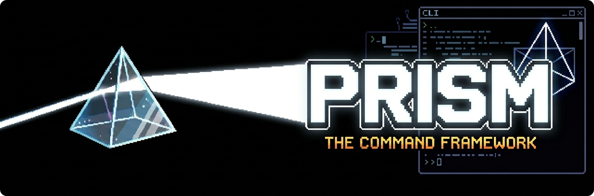

# 🌟 Prism - THE Command Framework

<div align="center">

A code-first command framework that lets you build commands directly in Java with a fluent, type-safe API.
**No annotations required.**



[](https://central.sonatype.com/namespace/dev.gurwi)
[](https://github.com/AthlasStudios/prism/actions/workflows/test.yml)
[](https://adoptium.net)
[](https://github.com/AthlasStudios/prism/blob/main/LICENSE)

[](https://github.com/AthlasStudios/prism/stargazers)
[](https://github.com/AthlasStudios/prism/issues)
[](https://github.com/AthlasStudios/prism/commits/main)


[Documentation](https://docs.gurwi.dev/prism) · [Issues](https://github.com/AthlasStudios/prism/issues)

</div>

---

## Table of contents

- [Overview](#overview)
- [Part 1 - The core](#part-1---the-core)
  - [Building blocks](#building-blocks)
  - [The builder API](#the-builder-api)
  - [Arguments](#arguments)
  - [Argument trees](#argument-trees)
  - [Executors](#executors)
  - [Permissions and requirements](#permissions-and-requirements)
  - [Suggestions](#suggestions)
  - [Reading values: CommandArguments](#reading-values-commandarguments)
  - [Platforms and registries](#platforms-and-registries)
- [Part 2 - Implementing a platform](#part-2---implementing-a-platform)
  - [1. Executor](#1-executor)
  - [2. Permissions](#2-permissions)
  - [3. Arguments and suggestions](#3-arguments-and-suggestions)
  - [4. Command definition](#4-command-definition)
  - [5. Builder](#5-builder)
  - [6. Platform and registry](#6-platform-and-registry)
  - [7. Dispatching input](#7-dispatching-input)
  - [8. Brigadier hosts](#8-brigadier-hosts-optional)
  - [Using your platform](#using-your-platform)
- [Part 3 - Platforms](#part-3---platforms)
  - [Overview and compatibility](#overview-and-compatibility)
  - [The Brigadier layer](#the-brigadier-layer)
  - [Bukkit family (Spigot and Paper)](#bukkit-family-spigot-and-paper)
    - [Spigot](#spigot)
    - [Paper](#paper)
    - [Bukkit guide](#bukkit-guide)
    - [Standalone plugin](#standalone-plugin)
  - [Velocity](#velocity)
  - [BungeeCord](#bungeecord)
  - [JDA (Discord)](#jda-discord)
- [Reference](#reference)
  - [Built-in argument types](#built-in-argument-types)
  - [Project structure](#project-structure)
- [Development](#development)
  - [Building from source](#building-from-source)
  - [Trying it out on a server](#trying-it-out-on-a-server)
  - [Contributing](#contributing)
- [License](#license)

---

## Overview

Most command frameworks lean on annotations and reflection: you describe a command with a pile of annotations, and the framework figures out the rest at runtime. Prism takes the opposite approach. A command is plain Java code built with a fluent builder, so you get:

- **Compile-time safety.** Arguments, executors and requirements are real typed objects, not strings buried in annotations.
- **Composability.** Commands are values. Build them in loops, share argument definitions, and assemble trees programmatically.
- **Discoverability.** Your IDE's autocomplete is the documentation. Everything hangs off one builder.
- **One API, many platforms.** The core is platform-agnostic; Spigot, Paper, Velocity, BungeeCord and others plug in on top.

```java
new PrismBukkitCommand("heal")
        .withDescription("Heal a player")
        .withPermission("myplugin.heal")
        .withArguments(new PlayerArgument("target"))
        .executes((sender, args) -> {
            Player target = args.get("target");
            target.setHealth(20);
            sender.sendMessage("Healed " + target.getName());
        })
        .register(platform);
```

**Highlights**

- 🧱 Fluent, type-safe builder API with no annotations
- 🌳 Subcommands and argument trees for arbitrarily nested command structures
- 🎯 Rich built-in arguments for players, worlds, materials, locations, entity selectors, ranges, colors, enchantments, potion effects and more
- 💡 Sync and async tab completion with optional tooltips
- 🚩 Flag support (`-c red -e`) via `FlagArgument`
- 🔐 Permissions and usage requirements at the command and argument level
- 🧭 Per-sender-type executors (player, console, remote console, command block, proxied)
- ⚡ Native Brigadier integration with an automatic legacy fallback
- 📖 Built-in help generator with clickable usage
- ♻️ Runtime registration and unregistration of commands
- 🧩 Shaded bundles, or a standalone plugin if you would rather not shade

**Where to go next**

| I want to...                                  | Read                                                                  |
|-----------------------------------------------|-----------------------------------------------------------------------|
| Understand how Prism is designed              | [Part 1 - The core](#part-1---the-core)                                |
| Add Prism to a new host (a game, a chat bot)  | [Part 2 - Implementing a platform](#part-2---implementing-a-platform)  |
| Write commands for a Minecraft server or proxy | [Part 3 - Platforms](#part-3---platforms)                              |

> Prism is currently in **beta** (`1.0.0-beta.10`). APIs may still change between beta releases.

---

# Part 1 - The core

The `core` module (`dev.gurwi:prism-core`) knows nothing about Minecraft, Discord or any other host. It defines the command model: how commands, arguments, executors, permissions and requirements are described, built and read back. Every platform is a thin layer on top of it, which is why a command looks the same everywhere.

The core targets **Java 11** and has no runtime dependencies besides the annotations it ships with.

## Building blocks

A platform binds a handful of generic types to its own host. Everything in the core is generic over them:

| Type parameter | Meaning                                                      | Example (Bukkit)         |
|----------------|--------------------------------------------------------------|--------------------------|
| `Source`       | Who runs a command or asks for suggestions                   | `CommandSender`          |
| `Executor`     | A functional interface invoked when the command runs         | `BukkitCommandExecutor`  |
| `Argument`     | The base argument class of the platform                      | `BukkitArgument`         |
| `Permission`   | The platform's permission node type                          | `BukkitPermission`       |
| `Definition`   | The immutable, built form of a command                       | `BukkitCommandDefinition` |

| Core type                                 | Role                                                                                                |
|-------------------------------------------|-----------------------------------------------------------------------------------------------------|
| `AbstractCommandBuilder`                  | The fluent builder. Collects name, aliases, description, arguments, executors, permissions, children. |
| `AbstractTreeCommandBuilder`              | Adds `then(...)` argument trees to the builder.                                                     |
| `AbstractCommandDefinition`               | The immutable result of `build()`. Holds the command tree and answers `canExecute(source)`.         |
| `AbstractArgument` / `AbstractTreeArgument` | A typed argument that turns raw input into a value. The tree variant can carry executors and branches. |
| `CommandExecutor<Source, Definition>`     | `run(source, args)`, the code a user attaches to a command.                                         |
| `CommandArguments`                        | The parsed values handed to an executor, plus the definition chain.                                  |
| `UsageRequirement<Source>`                | An arbitrary predicate on the source. Composable with `and(...)`.                                    |
| `PermissionNode<Permission, Source>`      | A permission value and a check for a given source.                                                   |
| `SuggestionsSupplier` / `SuggestionContext` | Produces tab-completion values for an argument.                                                    |
| `Platform` / `CommandsRegistry`           | The seam between the core and a host. See [Platforms and registries](#platforms-and-registries).     |

`ArgumentGroup` provides small helpers for applying one requirement to several arguments at once.

## The builder API

Every platform exposes a builder that extends `AbstractCommandBuilder`. The methods below are inherited, so they work identically on every platform.

| Method                                     | Description                                                                          |
|--------------------------------------------|--------------------------------------------------------------------------------------|
| `new Builder(name, aliases...)`            | The first argument is the command name; any further strings are aliases.             |
| `withDescription(text)`                    | Description shown in help and host listings.                                         |
| `withArguments(args...)`                   | Required arguments, parsed in order.                                                 |
| `withOptionalArguments(args...)`           | Optional arguments. They always come after the required ones.                        |
| `withSubCommands(commands...)`             | Nested commands. A subcommand is just another builder of the same type.              |
| `then(argument)`                           | Starts an [argument tree](#argument-trees) branch (tree builders only).              |
| `withPermission(nodes...)`                 | One or more permissions. Meaning of "multiple" is platform-defined, see the platform sections. |
| `withRequirement(requirement)`             | A predicate on the source.                                                           |
| `executes(type, executor)`                 | Registers an executor under its type. Platforms add friendlier shortcuts on top.     |
| `clearExecutors()`                         | Removes all executors from the builder.                                              |
| `build()`                                  | Returns the immutable definition.                                                    |
| `register(platform)` / `register(registry)` | Builds the command and hands it to the registry. Returns the definition.             |

Commands are plain values, so you can build them programmatically:

```java
for (String color : List.of("red", "green", "blue")) {
    new PrismBukkitCommand(color)
            .executes((sender, args) -> sender.sendMessage("You picked " + color))
            .register(platform);
}
```

## Arguments

An argument is a named, typed parser. Subclass `AbstractArgument` and implement one method:

```java
T parse(Source source, String value) throws ArgumentParseException;
```

Throw `ArgumentParseException` for invalid input and the platform turns it into a user-facing message. Arguments are configured fluently:

| Method                          | Description                                                                                  |
|---------------------------------|----------------------------------------------------------------------------------------------|
| `setListed(boolean)`            | Unlisted arguments are matched but never stored in `CommandArguments`. `LiteralArgument` is unlisted. |
| `replaceSuggestions(supplier)`  | Replace the argument's default suggestions.                                                  |
| `includeSuggestions(supplier)`  | Add suggestions on top of the defaults (can be called more than once).                       |
| `withRequirement(requirement)`  | Only sources that satisfy the requirement can use this argument. Requirements are combined with `and`. |
| `canUse(source)`                | Answers whether a source may use the argument. Platforms must honour it.                     |

Required arguments are parsed in order, then optional ones. **Greedy arguments must be the last argument of a command and cannot have children.**

## Argument trees

When a command needs different follow-up arguments depending on the path taken, use `then(...)`. Each branch can carry its own executors, and branches can be nested by calling `then(...)` on an argument.

```java
new PrismBukkitCommand("inspect")
        .withArguments(new ItemStackPredicateArgument("predicate"))
        .then(new MaterialArgument("material")
                .executes((sender, args) -> sender.sendMessage("Material: " + args.get("material"))))
        .then(new GameModeArgument("gamemode")
                .executes((sender, args) -> sender.sendMessage("Game mode: " + args.get("gamemode"))))
        .register(platform);
```

Argument names must be unique among siblings. The core throws an `IllegalArgumentException` if you reuse one or try to add an argument beneath itself.

Platforms that want trees extend `AbstractTreeArgument`, `AbstractTreeCommandBuilder` and `AbstractTreeCommandDefinition`. All platforms shipped today do.

## Executors

An executor is a functional interface over a source type and a definition type:

```java
@FunctionalInterface
public interface CommandExecutor<Source, Definition extends AbstractCommandDefinition<Definition, ? super Source, ?, ?, ?>> {
    void run(Source source, CommandArguments<Definition, ? super Source> args);
}
```

A command holds a map of executor types to executors. If your host has several kinds of senders (Bukkit's player, console and command block), declare one executor interface per kind and register each under its own type. The platform picks the one that matches the sender, so user code never needs `instanceof` checks.

## Permissions and requirements

- **Permissions** are `PermissionNode<Permission, Source>` values. `permission()` returns the host's native permission value and `hasPermission(source)` answers for a source.
- **Requirements** are arbitrary predicates on the source: `UsageRequirement<Source>`. Combine them with `and(...)`; `UsageRequirement.none()` always passes.

`AbstractCommandDefinition.canExecute(source)` evaluates the requirement and all permissions of a command in one call. Requirements can also be attached to individual arguments.

## Suggestions

Every argument can supply tab-completion values through a `SuggestionsSupplier`:

```java
@FunctionalInterface
public interface SuggestionsSupplier<Source, Result> {
    Result getSuggestions(SuggestionContext<Source> ctx);
}
```

`SuggestionContext` exposes the source (`getSource()`), the whole input typed so far (`getCurrentInput()`), the word being completed (`getCurrentRawArg()`) and whether the host already provides native suggestions (`hasNativeSuggestions()`). What a supplier returns, plain strings, tooltips, futures, is decided by each platform.

## Reading values: CommandArguments

Executors receive a `CommandArguments` with the parsed values. `get(...)` is generic, so the target type is inferred from the variable you assign it to. You can pass the argument's name or the argument object itself.

| Method                                              | Description                                                           |
|-----------------------------------------------------|-----------------------------------------------------------------------|
| `get(key)` / `get(argument)`                        | A required value.                                                     |
| `find(key)` / `find(argument)`                      | The value as an `Optional`.                                           |
| `getOptional(key)` / `getOptional(key, default)`    | An optional value, as an `Optional` or with a default.                |
| `getAt(path, key)`                                  | A value from a parent command, using a `../`-style path.              |
| `getOptionalAt(path, key[, default])`               | Like `getAt`, optional.                                               |
| `getParent()`, `getRoot()`, `getChain()`            | Walk the parsed hierarchy.                                            |
| `getDefinition()`, `getParentDefinition()`, `getRootDefinition()`, `getDefinitionChain()`, `getChildDefinitions()`, `getChildDefinition(name)`, `resolveDefinition(path)` | Inspect where you are in the definition tree. |

```java
new PrismBukkitCommand("paint")
        .withArguments(new ColorArgument("color"))
        .withSubCommands(
                new PrismBukkitCommand("show")
                        .executes((sender, args) -> sender.sendMessage("Color: " + args.getAt("../", "color")))
        )
        .register(platform);
```

## Platforms and registries

The core talks to a host through two small interfaces:

```java
public interface Platform<Registry extends CommandsRegistry<?, ?>> {
    String getIdentifier();
    Registry getCommandsRegistry();
}

public interface CommandsRegistry<PlatformType, Definition> {
    void register(Definition definition);
    void unregister(Definition definition);
    Set<Definition> getRegisteredCommands();   // unmodifiable view
    PlatformType getPlatform();
}
```

`builder.register(platform)` is a shortcut for `platform.getCommandsRegistry().register(builder.build())`. A command can be registered in either of two equivalent ways:

```java
// 1. Directly from the builder
BukkitCommandDefinition definition = new PrismBukkitCommand("hello")
        .executes((sender, args) -> sender.sendMessage("Hello!"))
        .register(platform);

// 2. Build first, register later
BukkitCommandDefinition built = new PrismBukkitCommand("hello")
        .executes((sender, args) -> sender.sendMessage("Hello!"))
        .build();

platform.getCommandsRegistry().register(built);
platform.getCommandsRegistry().unregister(built);
```

The `Prism` interface in the core lists the platform identifiers in use: `spigot`, `paper`, `bungeecord`, `velocity` and `jda`.

---

# Part 2 - Implementing a platform

A platform supplies six things on top of the core. Everything else (the fluent builder, argument trees, subcommands, requirements, `CommandArguments`) comes for free. The [`platform/bukkit`](platform/bukkit) module is the full-featured reference, [`platform/velocity`](platform/velocity) and [`platform/bungeecord`](platform/bungeecord) are compact Brigadier-only references, and [`platform/jda`](platform/jda) is a minimal skeleton that follows the same layout.

Add the core module (it is published on its own):

```kotlin
dependencies {
  api("dev.gurwi:prism-core:1.0.0-beta.10")
}
```

The examples below use an imaginary chat service where the command *source* is an `AcmeUser`.

## 1. Executor

An executor is a functional interface over your source type and your definition type.

```java
@FunctionalInterface
public interface AcmeExecutor extends CommandExecutor<AcmeUser, AcmeCommandDefinition> {
}
```

If your host has several kinds of senders, declare one executor interface per kind and register them under their own class, as `BukkitExecutorContainerBuilder` does.

## 2. Permissions

Implement `PermissionNode<Permission, Source>`.

```java
public record AcmePermission(String node) implements PermissionNode<String, AcmeUser> {

  @Override
  public String permission() {
    return node;
  }

  @Override
  public boolean hasPermission(AcmeUser user) {
    return user.hasPermission(node);
  }
}
```

## 3. Arguments and suggestions

Extend `AbstractArgument` with your source type and a `SuggestionsSupplier`. The one method you must implement is `parse`. Throw `ArgumentParseException` for invalid input.

```java
@FunctionalInterface
public interface AcmeSuggestions<T> extends SuggestionsSupplier<AcmeUser, Collection<T>> {
}

public abstract class AcmeArgument<Impl extends AcmeArgument<Impl, T>, T>
        extends AbstractArgument<Impl, T, AcmeUser, AcmeSuggestions<T>> {

  public AcmeArgument(String name) {
    super(name);
  }
}

public class AcmeIntegerArgument extends AcmeArgument<AcmeIntegerArgument, Integer> {

  public AcmeIntegerArgument(String name) {
    super(name);
  }

  @Override
  public Integer parse(AcmeUser source, String value) throws ArgumentParseException {
    try {
      return Integer.parseInt(value);
    } catch (NumberFormatException e) {
      throw new ArgumentParseException(this, value, "'" + value + "' is not a number");
    }
  }
}
```

The base class only stores user-provided suggestions (`replaceSuggestions`, `includeSuggestions`). Built-in defaults are up to your platform: fall back to them when `getSuggestionsSupplier()` is empty, as the Bukkit and Brigadier layers do.

If you want `then(...)` argument trees on your platform, extend `AbstractTreeArgument` here, and `AbstractTreeCommandBuilder` / `AbstractTreeCommandDefinition` in the next steps. This is what every shipped platform does.

## 4. Command definition

The definition is the immutable, built form of a command. Subclass `AbstractCommandDefinition` and bind its type parameters (self type, source, executor, argument, permission). The builder is the only thing that constructs it.

```java
public class AcmeCommandDefinition extends AbstractCommandDefinition<
        AcmeCommandDefinition, AcmeUser, AcmeExecutor, AcmeArgument<?, ?>, AcmePermission> {

  protected AcmeCommandDefinition(@Nullable AcmeCommandDefinition parent, String name, List<String> aliases,
                                  String description, UsageRequirement<AcmeUser> requirement,
                                  Set<AcmePermission> permissions,
                                  List<AcmeArgument<?, ?>> requiredArguments,
                                  List<AcmeArgument<?, ?>> optionalArguments,
                                  Map<Class<? extends AcmeExecutor>, AcmeExecutor> executors,
                                  CommandChildrenFactory<AcmeCommandDefinition> childrenFactory) {
    super(parent, name, aliases, description, requirement, permissions,
            requiredArguments, optionalArguments, executors, childrenFactory);
  }
}
```

The base class already gives you `getName()`, `getAliases()`, `getChildren()`, `getChild(name)`, `getParent()`, `getExecutor(type)`, `getExecutors()` and `canExecute(source)` (requirement plus all permissions).

## 5. Builder

Extend `AbstractCommandBuilder`, implement `build(parent)`, and add whatever convenience methods your executors need.

```java
public class AcmeCommandBuilder extends AbstractCommandBuilder<
        AcmeCommandBuilder, AcmeCommandDefinition, AcmeUser, AcmeExecutor, AcmeArgument<?, ?>, AcmePermission> {

  public AcmeCommandBuilder(String name, String... aliases) {
    super(name, aliases);
  }

  public AcmeCommandBuilder executes(AcmeExecutor executor) {
    return executes(AcmeExecutor.class, executor);
  }

  @Override
  public AcmeCommandDefinition build(@Nullable AcmeCommandDefinition parent) {
    return new AcmeCommandDefinition(parent, name, aliases, description, requirement, permissions,
            requiredArguments, optionalArguments, executors, CommandChildrenFactory.create(children));
  }
}
```

`withDescription`, `withArguments`, `withOptionalArguments`, `withPermission`, `withRequirement`, `withSubCommands` and `register(...)` are all inherited. `register(...)` passes the built definition to your registry, so the definition must never be `null`.

## 6. Platform and registry

The platform identifies itself and exposes its registry. The registry is where the work happens: it stores definitions and connects them to your host.

```java
public class AcmePlatform implements Platform<AcmeCommandsRegistry> {

  private final AcmeCommandsRegistry registry = new AcmeCommandsRegistry(this);

  @Override
  public String getIdentifier() {
    return "acme";
  }

  @Override
  public AcmeCommandsRegistry getCommandsRegistry() {
    return registry;
  }
}

public class AcmeCommandsRegistry implements CommandsRegistry<AcmePlatform, AcmeCommandDefinition> {

  private final AcmePlatform platform;
  private final Set<AcmeCommandDefinition> commands = new HashSet<>();

  public AcmeCommandsRegistry(AcmePlatform platform) {
    this.platform = platform;
  }

  @Override
  public void register(AcmeCommandDefinition definition) {
    commands.add(definition);
    // Tell your host about the command (name, aliases, description, ...)
  }

  @Override
  public void unregister(AcmeCommandDefinition definition) {
    commands.remove(definition);
    // Remove it from your host
  }

  @Override
  public @Unmodifiable Set<AcmeCommandDefinition> getRegisteredCommands() {
    return Set.copyOf(commands);
  }

  @Override
  public AcmePlatform getPlatform() {
    return platform;
  }
}
```

A registry should not register host event listeners on its own. Leave that to the user of your platform, as the Velocity registry does.

## 7. Dispatching input

If your host has no command system of its own, Prism does not parse or run anything by itself. When your host receives input for a registered command, your registry (or a helper it owns) does the following:

1. Walk the definition tree, matching subcommand names with `getChild(...)`.
2. Check `definition.canExecute(source)` and report a "no permission" error if it fails.
3. Parse the raw tokens with each argument's `parse(source, token)`, honouring `canUse(source)`, and collect the values into two maps keyed by argument name (required and optional). Catch `ArgumentParseException` and turn it into a user-facing message.
4. Wrap the values in a `CommandArguments`, passing the parent's `CommandArguments` so that `getAt("../", "key")` and friends work.
5. Look up the executor with `definition.getExecutor(...)` and call `run(source, args)` on it.

```java
CommandArguments<AcmeCommandDefinition, AcmeUser> args =
        new CommandArguments<>(definition, requiredValues, optionalValues, parentArgs);

definition.getExecutor(AcmeExecutor.class)
        .ifPresentOrElse(
                executor -> executor.run(user, args),
                () -> user.sendMessage("This command cannot be run here.")
        );
```

For suggestions, call each argument's suggestions supplier with `new SuggestionContext<>(source, currentInput, currentRawArg)` and translate the result into whatever your host expects.

## 8. Brigadier hosts (optional)

If your host already speaks Brigadier (Minecraft servers, Velocity) or you can run a `CommandDispatcher` behind it (BungeeCord), skip step 7. Add `prism-brigadier-api`, implement `BrigadierAdapter<Source, Definition>` and let `BrigadierTreeBuilder` build the command tree, parse the hierarchy and wire up suggestions.

| Method                                        | Purpose                                                                      |
|-----------------------------------------------|------------------------------------------------------------------------------|
| `visible(definition, source)`                 | Whether the source may see the command at all.                               |
| `available(argument, source)`                 | Whether the source may use an argument node.                                 |
| `forcedValues(argument)`                      | Fixed values an argument expands to. Defaults to none.                       |
| `accepts(argument, source, word)`             | Whether a single word parses for the argument.                               |
| `nativeType(argument)`                        | The Brigadier `ArgumentType` backing the argument, or `null` for literals.   |
| `tokens(argument)`                            | How many input words the argument consumes.                                  |
| `greedy(argument)` / `literal(argument)`      | Node kind.                                                                   |
| `branches(definition)` / `children(argument)` | The `then(...)` tree of a command or an argument.                            |
| `command(...)`                                | The Brigadier `Command` for a definition or a path inside its argument tree. |
| `suggestions(argument, nativeType)`           | The `SuggestionProvider` for an argument, falling back to the native type.   |

Your registry then turns each definition into Brigadier nodes. This is the Velocity version:

```java
for (String label : adapter.getBuilder().labels(definition)) {
    LiteralCommandNode<CommandSource> node = adapter.getBuilder().build(definition, label);
    BrigadierCommand command = new BrigadierCommand(node);

    CommandMeta meta = manager.metaBuilder(command)
            .plugin(platform.getPlugin())
            .build();

    manager.register(meta, command);
}
```

Read `BukkitCommandDefinitionAdapter` (`brigadier/brigadier-minecraft`), `VelocityCommandDefinitionAdapter` (`platform/velocity`) and `BungeecordCommandDefinitionAdapter` (`platform/bungeecord`) for three complete adapters.

## Using your platform

Once those pieces exist, users of your platform get the same fluent API as everyone else:

```java
AcmePlatform platform = new AcmePlatform();

new AcmeCommandBuilder("greet")
        .withArguments(new AcmeIntegerArgument("times"))
        .executes((user, args) -> {
            int times = args.get("times");
            user.sendMessage("Hello! ".repeat(times));
        })
        .register(platform);
```

> **Tip:** read `BukkitCommandsRegistry`, `LegacyCommandRegistrar` and `LegacyArgumentsParser` in `platform/bukkit` to see a complete implementation of steps 6 and 7, including tab completion, flags and greedy arguments.

---

# Part 3 - Platforms

## Overview and compatibility

| Platform               | Module                       | Artifact          | Status            | Java         | Brigadier                          |
|------------------------|------------------------------|-------------------|-------------------|--------------|------------------------------------|
| [Spigot](#spigot) (and forks) | `platform/spigot`     | `prism-spigot`    | Supported         | 11           | Version adapters, legacy fallback  |
| [Paper](#paper) (and forks)   | `platform/paper`      | `prism-paper`     | Supported         | 11           | Paper-native, legacy fallback      |
| [Velocity](#velocity)  | `platform/velocity`          | `prism-velocity`  | 🧪 Experimental   | 25           | Always (Velocity ships it)         |
| [BungeeCord](#bungeecord) (and forks) | `platform/bungeecord` | `prism-bungeecord` | 🧪 Experimental | 11          | Always (shaded by you)             |
| [JDA](#jda-discord) (Discord) | `platform/jda`        | not published     | 🚧 In development | 11           | n/a                                |

All artifacts use the group ID `dev.gurwi` and the same version (currently `1.0.0-beta.10`).

Three Gradle snippets cover every published artifact. Replace the artifact ID with the one from the table above:

```kotlin
// Gradle (Kotlin DSL)
repositories {
  mavenCentral()
}

dependencies {
  implementation("dev.gurwi:prism-paper:1.0.0-beta.10")
}
```

```groovy
// Gradle (Groovy DSL)
repositories {
  mavenCentral()
}

dependencies {
  implementation 'dev.gurwi:prism-paper:1.0.0-beta.10'
}
```

```xml
<!-- Maven -->
<dependency>
  <groupId>dev.gurwi</groupId>
  <artifactId>prism-paper</artifactId>
  <version>1.0.0-beta.10</version>
</dependency>
```

Prism is a library, not a plugin, so **shade it into your own plugin jar** (for example with the [Shadow](https://github.com/GradleUp/shadow) plugin) and relocate it to avoid conflicts with other plugins that bundle Prism. Don't want to shade? On Bukkit servers you can install Prism once as a [standalone plugin](#standalone-plugin).

## The Brigadier layer

Brigadier is Mojang's command library. Prism builds a Brigadier tree from every definition on all four Minecraft platforms, which gives players client-side validation, colored syntax and native suggestions.

| Module                       | Role                                                                                                |
|------------------------------|-----------------------------------------------------------------------------------------------------|
| `brigadier/brigadier-api`    | Platform-independent `BrigadierTreeBuilder` and `BrigadierAdapter` (see [Part 2](#8-brigadier-hosts-optional)). |
| `brigadier/brigadier-minecraft` | Bridge to Minecraft's own Brigadier: dispatcher access, wrapped argument types and sources, and the Bukkit adapter. |
| `brigadier/nms/V1_13 … V1_21, V26` | One adapter per Minecraft version, used by the Spigot bundle.                                 |
| `brigadier/brigadier-paper`  | Adapter built on Paper's own Brigadier API, used by the Paper bundle.                                |

Prism compiles against the Spigot 1.13.2 API and has adapters for Minecraft **1.13 through 1.21 and 26.x**. If Brigadier cannot be initialized on your server version, Prism logs a warning and falls back to legacy registration, so commands keep working. You never depend on these modules directly: the Spigot and Paper bundles include what they need.

## Bukkit family (Spigot and Paper)

`platform/bukkit` is the shared Bukkit API layer. It contains `PrismBukkitCommand`, every Bukkit [argument](#built-in-argument-types), the executors, permissions, the legacy registrar and the help generator. `platform/spigot` and `platform/paper` are thin platform classes on top of it, and each one is published as a self-contained **bundle**: the core, the Bukkit layer and the matching Brigadier adapters in one dependency.

Everything in the [Bukkit guide](#bukkit-guide) works the same on both.

### Spigot

| Property | Value |
|----------|-------|
| Artifact | `prism-spigot` |
| Platform class | `SpigotPlatform` |
| Registry | `SpigotCommandsRegistry` |
| Compiles against | Spigot API 1.13.2 |
| Brigadier | Per-version NMS adapters (1.13 to 1.21, 26.x), legacy fallback |

```java
public class MyPlugin extends JavaPlugin {

  private SpigotPlatform platform;

  @Override
  public void onEnable() {
    this.platform = SpigotPlatform.configure(this).init();
  }
}
```

Spigot has no Paper-specific listeners, so the platform needs no extra setup. Options are listed under [Bukkit platform configuration](#platform-configuration).

### Paper

| Property | Value |
|----------|-------|
| Artifact | `prism-paper` |
| Platform class | `PaperPlatform` |
| Registry | `PaperCommandsRegistry` |
| Brigadier | Paper-native adapter, legacy fallback |
| Extras | Async tab completion through a dedicated listener |

```java
public class MyPlugin extends JavaPlugin {

  private PaperPlatform platform;

  @Override
  public void onEnable() {
    this.platform = PaperPlatform.configure(this).init();
  }
}
```

On Paper, async suggestions are handled by a listener Prism registers for you. Turn it off with `disableAsyncSuggestions()` if you don't need it.

### Platform configuration

`configure(plugin)` returns a builder. Finish with `.init()`.

| Option                                         | Platform      | Description                                                                      |
|------------------------------------------------|---------------|----------------------------------------------------------------------------------|
| `disableBrigadier()`                           | Paper, Spigot | Skip Brigadier and register through the legacy command system only.              |
| `disableLegacyRegistrar()`                     | Paper, Spigot | Disable the legacy registrar.                                                    |
| `disableAsyncSuggestions()`                    | Paper         | Don't register the async tab-completion listener.                                |
| `registerPermissions(boolean)`                 | Paper, Spigot | Toggle command permission registration. Defaults to `true`.                      |
| `withGlobalLegacyCommandErrorHandler(handler)` | Paper, Spigot | Set the default handler for argument-parse errors on legacy-registered commands. |

```java
PaperPlatform platform = PaperPlatform.configure(this)
        .disableAsyncSuggestions()
        .registerPermissions(false)
        .init();
```

Individual commands can override the error handler with `replaceErrorHandler(...)`. Prism ships `LegacyCommandExecutionErrorHandler.defaultHandler()` and `consoleHandler()`, and you can implement the interface yourself.

### Bukkit guide

The guide uses `PrismBukkitCommand`. Platform setup is shown above; the snippets assume a `platform` variable.

#### Quick start

```java
new PrismBukkitCommand("teleport", "tp")
        .withDescription("Teleport yourself to a location")
        .withPermission("myplugin.teleport")
        .withArguments(new LocationArgument("location"))
        .executesPlayer((player, args) -> {
            Location location = args.get("location");
            player.teleport(location);
            player.sendMessage("Teleported!");
        })
        .register(platform);
```

Tab completion, argument parsing and error messages come for free.

#### Arguments

Required arguments are added with `withArguments(...)`, parsed in order, and read back by name.

```java
new PrismBukkitCommand("give")
        .withArguments(
                new PlayerArgument("target"),
                new MaterialArgument("material"),
                new IntegerArgument("amount", 1, 64)
        )
        .executes((sender, args) -> {
            Player target = args.get("target");
            Material material = args.get("material");
            int amount = args.get("amount");

            target.getInventory().addItem(new ItemStack(material, amount));
        })
        .register(platform);
```

You can also pass the argument object instead of its name:

```java
IntegerArgument amount = new IntegerArgument("amount", 1, 64);
// ...
int value = args.get(amount);
```

#### Optional arguments

Optional arguments are declared with `withOptionalArguments(...)` and always come after the required ones.

```java
new PrismBukkitCommand("number")
        .withArguments(new IntegerArgument("number", 0, 10))
        .withOptionalArguments(new FloatArgument("float", 0.1f, 9.9f))
        .executes((sender, args) -> {
            int number = args.get("number");
            float scale = args.getOptional("float", 1.0f); // with a default
            sender.sendMessage(number + " x " + scale);
        })
        .register(platform);
```

#### Subcommands

```java
new PrismBukkitCommand("team", "t")
        .withDescription("Team management")
        .withSubCommands(
                new PrismBukkitCommand("create")
                        .withArguments(new StringArgument("name"))
                        .executes((sender, args) -> sender.sendMessage("Created team " + args.get("name"))),

                new PrismBukkitCommand("join")
                        .withArguments(new StringArgument("name"))
                        .executesPlayer((player, args) -> player.sendMessage("Joined team " + args.get("name")))
        )
        .register(platform);
```

#### Argument trees

See [Argument trees](#argument-trees) in the core. Bukkit arguments such as `MaterialArgument` and `GameModeArgument` can carry their own executors.

#### Executors and senders

Pick the executor that matches who may run the command:

| Method                       | Sender type                 |
|------------------------------|-----------------------------|
| `executes(...)`              | Any `CommandSender`         |
| `executesPlayer(...)`        | `Player`                    |
| `executesConsole(...)`       | `ConsoleCommandSender`      |
| `executesRemoteConsole(...)` | `RemoteConsoleCommandSender` |
| `executesProxy(...)`         | `ProxiedCommandSender`      |
| `executesBlock(...)`         | `BlockCommandSender`        |

You can register several executors on the same command, one per sender type:

```java
new PrismBukkitCommand("whoami")
        .executesPlayer((player, args) -> player.sendMessage("You are " + player.getName()))
        .executesConsole((console, args) -> console.sendMessage("You are the console"))
        .register(platform);
```

A sender with no matching executor gets "This command cannot be run by this sender" on Brigadier platforms, and the command is hidden from its suggestions.

#### Permissions and requirements

Permissions are checked against the sender, and operators always pass:

```java
new PrismBukkitCommand("admin")
        .withPermission("myplugin.admin", "myplugin.staff")
// ...
```

For wildcard-style checks, `BukkitPermission.startsWith("myplugin.")` matches any effective permission with that prefix.

Requirements are arbitrary predicates on the sender. Sender-specific shortcuts are available:

```java
new PrismBukkitCommand("fly")
        .withPlayerRequirement(player -> player.getWorld().getName().equals("lobby"))
        .executesPlayer((player, args) -> player.setAllowFlight(true))
        .register(platform);
```

Helpers: `withRequirement`, `withPlayerRequirement`, `withConsoleRequirement`, `withRemoteConsoleRequirement`, `withProxyRequirement` and `withBlockRequirement`. Requirements can also be attached to individual arguments.

#### Suggestions and tab completion

Every built-in argument ships with sensible default suggestions. Replace them with `replaceSuggestions(...)`, or add to them with `includeSuggestions(...)`.

```java
// Static strings
new IntegerArgument("number", 0, 10).replaceSuggestions("5", "10");

// Synchronous, computed suggestions with tooltips
new StringArgument("kit").replaceSuggestions(
        BukkitSuggestionsSupplier.sync(ctx -> List.of(
                ArgumentSuggestion.of("starter", "The default starter kit"),
                ArgumentSuggestion.of("vip", "Perks for VIP players")
        ))
);

// Asynchronous suggestions (database or network lookups)
new StringArgument("player").replaceSuggestions(
        BukkitSuggestionsSupplier.async(ctx -> CompletableFuture.supplyAsync(() ->
                List.of(ArgumentSuggestion.of("alpha", "first async value"))
        ))
);
```

`SuggestionContext#getCurrentRawArg()` gives you the text being completed. `BukkitSuggestionsSupplier.strings(...)` and `stringsAsync(...)` cover the plain-string cases. On Brigadier platforms Prism also filters suggestions by the text already typed (case-insensitive prefix match), so suppliers can return their full list.

#### Flags

`FlagArgument` parses `-x`-style flags in any order. Flags can carry a value (using any other argument type) or act as on/off switches.

```java
new PrismBukkitCommand("flagger")
        .withArguments(
                new FlagArgument("flags").flags(
                        Flag.valued(new ColorArgument("color"), 'c'),
                        Flag.presence("enable", 'e')
                )
        )
        .executesPlayer((player, args) -> {
            ParsedFlags flags = args.get("flags");
            Optional<ChatColor> color = flags.get("color");

            color.ifPresent(c -> player.sendMessage("Color: " + c.name()));
        })
        .register(platform);
```

#### Built-in help

`CommandHelp` renders a clickable usage list for the current command, including its subcommands and argument-tree branches. It only shows entries the sender is allowed to run.

```java
new PrismBukkitCommand("myplugin")
        .withSubCommands(/* ... */)
        .executesPlayer((player, args) -> CommandHelp.help(player, args))
        .register(platform);
```

Pass two extra `ChatColor` values to `CommandHelp.help(sender, args, primary, secondary)` to restyle it.

#### Registering and unregistering

See [Platforms and registries](#platforms-and-registries). `platform.getCommandsRegistry().getRegisteredCommands()` returns an unmodifiable view of everything registered on the platform.

### Standalone plugin

Instead of shading Prism into every plugin, you can install it once on the server as a plugin named `prism`. Your plugins then depend on it, share one copy of the library and get their commands registered through the Prism API. This is the Bukkit plugin in `plugin/bukkit-plugin`, built on the [Paper platform](#paper).

#### Install the plugin

1. Drop `prism-<version>.jar` into the server's `plugins` folder.
2. Start the server once. The plugin creates `plugins/prism/config.yml`.
3. Add Prism as a dependency of every plugin that uses it.

The plugin also adds a `/prism` command that shows basic info and links to this repository. It can be turned off in the config.

#### Use it from your plugin

Declare the dependency in your `plugin.yml`, so Prism always loads first:

```yaml
name: MyPlugin
main: com.example.myplugin.MyPlugin
version: 1.0.0
depend: [prism]
```

Compile against Prism without shading it. The API classes come from the `api` module, which builds to `prism-<version>-API.jar`, and the command classes come from the matching Prism module:

```kotlin
dependencies {
  compileOnly("dev.gurwi:prism-paper:1.0.0-beta.10")
  compileOnly(files("libs/prism-1.0.0-beta.10-API.jar"))
}
```

Everything is `compileOnly`: at runtime the classes come from the installed Prism plugin, so there is nothing to shade or relocate.

There are two ways to register commands: let Prism pick them up from a [command provider](#command-providers), or use the API and a registry yourself. Get the API through `PrismPluginAPI.getAPI()`. It returns `null` when Prism is not installed or has not registered its service yet.

```java
public class MyPlugin extends JavaPlugin {

  @Override
  public void onEnable() {
    PrismPluginAPI api = PrismPluginAPI.getAPI();

    if (api == null) {
      getLogger().severe("Prism is not installed");
      getServer().getPluginManager().disablePlugin(this);
      return;
    }

    BukkitCommandsRegistry<?> registry = api.createRegistry(this);

    registry.register(
            new PrismBukkitCommand("hello")
                    .executes((sender, args) -> sender.sendMessage("Hello!"))
                    .build()
    );
  }
}
```

Commands are built with the same `PrismBukkitCommand` API as in the [Bukkit guide](#bukkit-guide). Instead of `.register(platform)` you pass the built definition to a registry.

| Method                                         | Description                                                                |
|------------------------------------------------|----------------------------------------------------------------------------|
| `PrismPluginAPI.getAPI()`                      | The API instance, or `null` if Prism is missing.                           |
| `createRegistry(plugin)`                       | Creates a registry for your plugin, configured from Prism's `config.yml`.  |
| `getDefaultRegistry()`                         | The registry of Prism's own platform, shared by all plugins.               |
| `registerProvider(plugin, provider, registry)` | Registers a [command provider](#command-providers). `registry` may be `null`. |
| `getRegistriesManager()`                       | `createRegistry`, `getRegistry(plugin)` and `unloadRegistry(plugin)`.      |

Prefer `createRegistry(this)` so your commands are tracked per plugin.

#### Command providers

If you only want commands registered, implement `PrismCommandProvider` on your main class and return them from `getCommands()`. Prism detects the provider when your plugin enables, builds every command and registers it. There is no registry code in your plugin.

```java
public class MyPlugin extends JavaPlugin implements PrismCommandProvider {

  @Override
  public Collection<? extends PrismBukkitCommand> getCommands() {
    return List.of(
            new PrismBukkitCommand("hello")
                    .executes((sender, args) -> sender.sendMessage("Hello!")),

            new PrismBukkitCommand("ping")
                    .executes((sender, args) -> sender.sendMessage("Pong!"))
    );
  }
}
```

Return the builders, not built definitions: Prism calls `build()` itself.

By default each plugin gets its own registry, created from Prism's `config.yml`, and its commands are unregistered when the plugin disables. To choose the registry yourself, override `getRegistry()`:

```java
@Override
public BukkitCommandsRegistry<?> getRegistry() {
  return PrismPluginAPI.getAPI().getDefaultRegistry();
}
```

A provider does not have to be your main class. Register any provider by hand with `registerProvider`:

```java
PrismPluginAPI.getAPI().registerProvider(this, () -> List.of(
        new PrismBukkitCommand("hello")
                .executes((sender, args) -> sender.sendMessage("Hello!"))
), null);
```

Passing `null` as the registry uses the provider's `getRegistry()`, then falls back to a per-plugin registry. Your plugin must still declare `depend: [prism]`; Prism logs a warning for providers that don't.

#### Plugin configuration

`plugins/prism/config.yml` controls how Prism creates its platform and the registries it hands out. It applies to every plugin using the standalone Prism.

| Option                      | Default | Maps to                        | Description                                                  |
|-----------------------------|---------|--------------------------------|--------------------------------------------------------------|
| `disableInfoCommand`        | `false` | n/a                            | Don't register the `/prism` info command.                    |
| `disableBrigadierRegistrar` | `false` | `disableBrigadier()`           | Skip Brigadier and register through the legacy system only.  |
| `disableLegacyRegistrar`    | `false` | `disableLegacyRegistrar()`     | Disable the legacy registrar.                                |
| `disableAsyncSuggestions`   | `false` | `disableAsyncSuggestions()`    | Don't register the async tab-completion listener.            |
| `registerPermissions`       | `false` | `registerPermissions(boolean)` | Register command permissions with the server.                |

Note that the plugin's default for `registerPermissions` is `false`, while the platform builder's own default is `true`.

## Velocity

| Property | Value |
|----------|-------|
| Status | 🧪 Experimental |
| Artifact | `prism-velocity` (pulls in `prism-core` and `prism-brigadier-api`) |
| Platform class | `VelocityPlatform` |
| Command class | `VelocityCommand` |
| Sender | Velocity's `CommandSource` |
| Java | **25**, Velocity 4.x API |
| Brigadier | Always. There is no legacy fallback. |

Velocity ships Brigadier itself, so there is nothing extra to shade. It has no bundle: depend on the platform module directly.

```kotlin
dependencies {
  implementation("dev.gurwi:prism-velocity:1.0.0-beta.10")
}
```

The platform reuses the core builder and the Brigadier tree builder, so commands, subcommands, argument trees, optional arguments and suggestions work as described in the [core](#part-1---the-core) and the [Bukkit guide](#bukkit-guide).

### Setup

Create the platform in your plugin constructor and register commands from your `ProxyInitializeEvent` handler or later.

```java
@Plugin(id = "my-plugin")
public class MyPlugin {

  private final ProxyServer server;
  private final VelocityPlatform platform;

  @Inject
  public MyPlugin(ProxyServer server) {
    this.server = server;
    this.platform = VelocityPlatform.configure(this, server).init();
  }

  @Subscribe
  public void onProxyInit(ProxyInitializeEvent event) {
    new VelocityCommand("hello")
            .executes((source, args) -> source.sendPlainMessage("Hello World!"))
            .register(platform);
  }
}
```

- `VelocityPlatform.configure(plugin, server)` takes your plugin instance as a plain `Object`. Velocity has no plugin handle: `@Plugin` is an annotation, and the instance of your main class is the plugin. The class must carry `@Plugin`, otherwise `configure` throws an `IllegalArgumentException`.
- Prism does not register any Velocity event listener. `register(...)` talks to Velocity's `CommandManager` immediately, so calling it before `ProxyInitializeEvent` is your responsibility to avoid.
- Velocity injects the SLF4J `Logger`, not `java.util.logging.Logger`.

### Executors

| Method                | Sender type            |
|-----------------------|------------------------|
| `executes(...)`       | Any `CommandSource`    |
| `executesPlayer(...)` | `Player`               |
| `executesConsole(...)`| `ConsoleCommandSource` |

### Permissions and requirements

Velocity has no operator system, so there is no `OP` permission. Permissions go through `CommandSource#hasPermission`, and `ConsoleCommandSource` always passes.

```java
VelocityPermission.of("myplugin.admin");
VelocityPermission.of("myplugin.admin", "myplugin.staff");
```

Without a permission plugin such as LuckPerms, Velocity's default provider returns `true` for every `hasPermission` call, so any player passes any permission check. Don't rely on permissions for anything sensitive unless a permission plugin is installed.

Velocity cannot enumerate the permissions a source holds, so a prefix check works against a known set of nodes instead of the sender's effective permissions:

```java
VelocityPermission.startsWith("myplugin.admin.", knownPermissions);
```

`knownPermissions` is the collection of nodes your commands declare. Only nodes in that collection are tested, and each one is checked with `hasPermission`. Use the LuckPerms API directly if you need to match arbitrary nodes at runtime.

### Arguments

Velocity arguments live in `dev.gurwi.prism.velocity.argument` and extend `VelocityArgument`. Each one wraps a Brigadier `ArgumentType`. See the [argument reference](#built-in-argument-types).

### Differences from Bukkit

| Topic                   | Bukkit platforms              | Velocity                              |
|-------------------------|-------------------------------|---------------------------------------|
| Command class           | `PrismBukkitCommand`          | `VelocityCommand`                     |
| Sender                  | `CommandSender`               | `CommandSource`                       |
| Plugin handle           | `JavaPlugin`                  | `Object` (your plugin instance)       |
| Registration timing     | `onEnable`                    | `ProxyInitializeEvent` or later       |
| Operators               | Always pass permission checks | No operator concept                   |
| `startsWith` permission | Matches effective permissions | Matches a supplied set of known nodes |
| Brigadier fallback      | Legacy registrar              | None, Brigadier only                  |
| Suggestion tooltips     | `LiteralMessage`              | `VelocityBrigadierMessage`            |

## BungeeCord

| Property | Value |
|----------|-------|
| Status | 🧪 Experimental |
| Artifact | `prism-bungeecord` (pulls in `prism-core` and `prism-brigadier-api`) |
| Platform class | `BungeecordPlatform` |
| Command class | `BungeecordCommand` |
| Sender | BungeeCord's `CommandSender` |
| Java | **11**, BungeeCord API `1.21` |
| Brigadier | Always, through a dispatcher behind a regular BungeeCord command |

BungeeCord does not expose Brigadier to plugins, so **shade `com.mojang:brigadier` into your plugin** as well (the [example plugin](examples/bungeecord-plugin/build.gradle.kts) uses `1.0.18`).

```kotlin
dependencies {
  implementation("dev.gurwi:prism-bungeecord:1.0.0-beta.10")
  implementation("com.mojang:brigadier:1.0.18")
}
```

The platform reuses the core builder and the Brigadier tree builder, so commands, subcommands, argument trees, optional arguments and suggestions work as described in the [core](#part-1---the-core) and the [Bukkit guide](#bukkit-guide).

### Setup

Create the platform in `onEnable` and register commands right after.

```java
public class MyPlugin extends Plugin {

  private BungeecordPlatform platform;

  @Override
  public void onEnable() {
    this.platform = BungeecordPlatform.configure(this).init();

    new BungeecordCommand("hello")
            .withOptionalArguments(new IntegerArgument("n", 0, 10))
            .executes((sender, args) -> sender.sendMessage("Hello World!"))
            .register(platform);
  }
}
```

`register(...)` adds one BungeeCord `Command` per label (name and aliases) to the `PluginManager`. Input is parsed and executed by a Brigadier dispatcher behind it, and tab completion comes from the same tree. Unregistering a command removes those commands again.

### Executors

| Method                | Sender type       |
|-----------------------|-------------------|
| `executes(...)`       | Any `CommandSender` |
| `executesPlayer(...)` | `ProxiedPlayer`   |
| `executesConsole(...)`| Console           |

### Command tree injection

BungeeCord's own tab completion does not know about Prism's argument types. To fix that, Prism hooks each player's connection on login and rewrites the command packet sent to the client, so the client sees your real command tree with typed arguments and native syntax highlighting.

This relies on BungeeCord internals. If the layout is not what Prism expects, it logs a message and carries on without injection: commands still run, and tab completion still works through the regular BungeeCord path. It is enabled by default and can be turned off:

```java
BungeecordPlatform platform = BungeecordPlatform.configure(this)
        .disableCommandTreeInjection()
        .init();
```

### Permissions and requirements

```java
new BungeecordCommand("admin")
        .withPermission("myplugin.admin", "myplugin.staff")
        .withPlayerRequirement(player -> player.getServer() != null)
        .executesPlayer((player, args) -> player.sendMessage("Hello admin"))
        .register(platform);
```

Permissions are only enforced for `ProxiedPlayer` senders: the console always passes. Requirement helpers: `withRequirement`, `withPlayerRequirement` and `withConsoleRequirement`.

BungeeCord cannot enumerate the permissions a player holds, so `BungeecordPermission.startsWith(prefix, knownPermissions)` works the same way as on Velocity: it tests the nodes you supply.

### Arguments

BungeeCord arguments live in `dev.gurwi.prism.bungeecord.argument` and extend `BungeecordArgument`. Each one wraps a Brigadier `ArgumentType`. See the [argument reference](#built-in-argument-types).

### Differences from Bukkit

| Topic                   | Bukkit platforms                              | BungeeCord                       |
|-------------------------|-----------------------------------------------|----------------------------------|
| Command class           | `PrismBukkitCommand`                          | `BungeecordCommand`              |
| Sender                  | `CommandSender`                               | `CommandSender` (BungeeCord's)   |
| Plugin handle           | `JavaPlugin`                                  | `Plugin`                         |
| Executors               | Player, console, remote console, proxy, block | Generic, player, console         |
| Operators               | Always pass permission checks                 | No operator concept              |
| Non-player permissions  | Checked normally                              | Console always passes            |
| `startsWith` permission | Matches effective permissions                 | Matches a supplied set of known nodes |
| Client-side tree        | Native Brigadier                              | Optional packet injection        |
| Brigadier fallback      | Legacy registrar                              | None, Brigadier only             |
| Suggestion tooltips     | `LiteralMessage`                              | Not supported                    |

## JDA (Discord)

| Property | Value |
|----------|-------|
| Status | 🚧 In development, not published |
| Module | `platform/jda` |
| Source | JDA `User` |

The JDA module is only a skeleton for now: it has a platform, registry, builder, definition, executor and argument base class, but the registry does not register or dispatch anything and there are no concrete arguments yet. It is a good template for [implementing your own platform](#part-2---implementing-a-platform), not something to depend on.

---

# Reference

## Built-in argument types

### Bukkit (Spigot and Paper)

All of these live in `dev.gurwi.prism.bukkit.argument`.

| Category                      | Arguments                                                                                                                                                                                                                                                    |
|-------------------------------|--------------------------------------------------------------------------------------------------------------------------------------------------------------------------------------------------------------------------------------------------------------|
| **Primitives**                | `StringArgument`, `GreedyStringArgument`, `MultiStringArgument`, `CharacterArgument`, `BooleanArgument`, `ByteArgument`, `ShortArgument`, `IntegerArgument`, `LongArgument`, `FloatArgument`, `DoubleArgument`, `UUIDArgument`                               |
| **Ranges**                    | `ByteRangeArgument`, `ShortRangeArgument`, `IntegerRangeArgument`, `LongRangeArgument`, `FloatRangeArgument`, `DoubleRangeArgument`, `NumberRangeArgument`                                                                                                   |
| **Players and entities**      | `PlayerArgument`, `OfflinePlayerArgument`, `EntityTypeArgument`, `EntitySelectorArgument` (e.g. `ManyEntities`)                                                                                                                                              |
| **World and position**        | `WorldArgument`, `LocationArgument`, `ColumnLocationArgument`, `BlockPositionArgument`, `ColumnBlockPositionArgument`, `VectorArgument`, `RotationArgument`, `AngleArgument`, `AxesArgument`                                                                 |
| **Blocks and items**          | `MaterialArgument`, `BlockStateArgument`, `BlockPredicateArgument`, `ItemStackPredicateArgument`, `EnchantmentArgument`                                                                                                                                      |
| **Game enums and registries** | `GameModeArgument`, `DifficultyArgument`, `WeatherArgument`, `BiomeArgument`, `PotionEffectTypeArgument`, `ParticleArgument`, `SoundArgument`, `DisplaySlotArgument`, `NamespacedKeyArgument`, `MirrorArgument`, `StructureRotationArgument`, `EnumArgument` |
| **Text and color**            | `ColorArgument`, `HexColorArgument`, `MessageArgument`, `TimeArgument`                                                                                                                                                                                       |
| **Structure**                 | `LiteralArgument`, `FlagArgument`                                                                                                                                                                                                                            |

### Velocity and BungeeCord

A smaller, platform-neutral set. Velocity arguments live in `dev.gurwi.prism.velocity.argument`, BungeeCord arguments in `dev.gurwi.prism.bungeecord.argument`.

| Category       | Arguments                                                                                                                                                  |
|----------------|------------------------------------------------------------------------------------------------------------------------------------------------------------|
| **Primitives** | `StringArgument`, `GreedyStringArgument`, `QuotedStringArgument`, `BooleanArgument`, `IntegerArgument`, `LongArgument`, `FloatArgument`, `DoubleArgument` |
| **Ranges**     | `IntegerRangeArgument`, `LongRangeArgument`, `FloatRangeArgument`, `DoubleRangeArgument`                                                                   |
| **Other**      | `EnumArgument`, `LiteralArgument`                                                                                                                          |

### Custom arguments

Need something custom? Extend `BukkitArgument` (or `VelocityArgument`, `BungeecordArgument`, or one of the `base` argument classes) and implement `parse(...)`, and optionally provide default suggestions. On a new platform, start from `AbstractArgument` as shown in [Part 2](#3-arguments-and-suggestions).

> Greedy arguments must be the last argument of a command and cannot have children.

## Project structure

Prism is a multi-module Gradle build:

```
prism
├── core/                  Platform-agnostic command model: builders, arguments, executors, permissions
├── reflection/            Small reflection helpers shared across platform modules
├── platform/
│   ├── bukkit/            Shared Bukkit API layer: PrismBukkitCommand, arguments, executors, legacy registrar
│   ├── spigot/            Spigot platform and registry
│   ├── paper/             Paper platform and registry (async suggestions, Paper-native Brigadier)
│   ├── velocity/          Velocity platform and registry (VelocityCommand, VelocityPermission, Brigadier adapter)
│   ├── bungeecord/        BungeeCord platform and registry (BungeecordCommand, command shim, tree injector)
│   └── jda/               Discord (JDA) platform, in development
├── brigadier/
│   ├── brigadier-api/     Platform-independent Brigadier tree builder and adapter
│   ├── brigadier-minecraft/  Minecraft-facing Brigadier bridge
│   ├── brigadier-paper/   Paper-native adapter
│   └── nms/               Per-version adapters: V1_13 … V1_21, V26
├── bundles/
│   ├── paper-bundle/      Aggregates modules into the `prism-paper` bundle
│   └── spigot-bundle/     Aggregates modules into the `prism-spigot` bundle
├── build-logic/
│   └── spigot-nms/        Gradle plugin for Spigot NMS reobfuscation
├── buildSrc/              Shared publishing conventions
├── plugin/
│   └── bukkit-plugin/     Standalone Prism plugin (`api/` for dependents, `plugin/` for the jar)
└── examples/
    ├── paper-plugin/      Paper example plugin
    ├── velocity-plugin/   Velocity example plugin
    └── bungeecord-plugin/ BungeeCord example plugin
```

---

# Development

## Building from source

**Requirements**

- A JDK that Gradle can use for toolchains. The library itself targets **Java 11**, tests run on **Java 21**, and the Paper example plugin, the Velocity module and CI use **Java 25**. Gradle's toolchain resolver can download missing JDKs automatically.
- Gradle itself must run on JDK 25 or newer while the Velocity module is part of the build. Set the Gradle JVM in your IDE accordingly.
- No separate Gradle install is needed. Use the included wrapper.

```bash
git clone https://github.com/AthlasStudios/prism.git
cd prism

# Compile everything and build the jars
./gradlew build

# Run the test suite
./gradlew test
```

On Windows, use `gradlew.bat` instead of `./gradlew`. Tests use [JUnit](https://junit.org/) with [MockBukkit](https://github.com/MockBukkit/MockBukkit).

## Trying it out on a server

The example plugins start a local server or proxy with Prism installed:

| Platform   | Run                                                     | Notes                                                                                   |
|------------|---------------------------------------------------------|-----------------------------------------------------------------------------------------|
| Paper      | `./gradlew :examples:paper-plugin:runServer`            | Exercises most of the API: subcommands, trees, flags, async and sync suggestions, many argument types. |
| Velocity   | `./gradlew :examples:velocity-plugin:runVelocity`       | Minimal plugin.                                                                         |
| BungeeCord | `./gradlew :examples:bungeecord-plugin:runWaterfall`    | Minimal plugin on Waterfall.                                                            |

To produce the Paper plugin jar instead, run `./gradlew :examples:paper-plugin:shadowJar`. Its source, [`PaperExample.java`](examples/paper-plugin/src/main/java/dev/gurwi/prism/example/paper/plugin/PaperExample.java), doubles as a handy set of usage examples.

## Contributing

Contributions, bug reports and ideas are welcome.

1. [Open an issue](https://github.com/AthlasStudios/prism/issues) to discuss larger changes before starting.
2. Fork the repository and create a branch from `main`.
3. Make your change and add or update tests where it makes sense.
4. Run `./gradlew test` and make sure it passes. The same check runs in CI on every push and pull request.
5. Open a pull request describing what changed and why.

## License

Prism is released under the [MIT License](https://opensource.org/license/mit).

---

<div align="center">

Made by [Gurwi](https://gurwi.dev) · [Athlas Studios](https://github.com/AthlasStudios)

</div>
